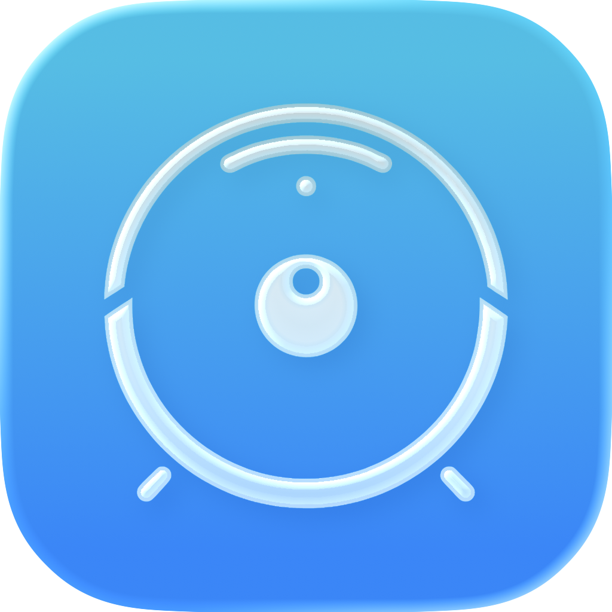

<p align="center">
  
</p>

<h1 align="center">VacuPilot</h1>

<p align="center">
  The native iOS app for robot vacuums running open-source firmware with a local REST API.<br>
  Full control. No cloud. No tracking. Just your robot, your network, your data.
</p>

<p align="center">
  
  
  
  
  
</p>

## About

Many robot vacuums can run an open-source firmware that replaces the vendor
cloud with a local REST API on the robot itself. That is good for privacy,
but the robot's own web interface is awkward on a phone.

VacuPilot is a native iPhone app for exactly these robots. It talks to the
robot directly on your network — no account, no cloud, no server in between.
Credentials stay in the device keychain.

## Features

### Robot Control
- **Multi-Robot Support** — Manage all your robots in one app
- **Real-Time Status** — Battery, cleaning status, and live statistics via SSE (Server-Sent Events)
- **Full Control** — Start, stop, pause, return to dock
- **Manual Control** — Joystick-style driving with high-resolution controls
- **Fan Speed & Water Usage** — Adjust intensity presets per cleaning session
- **Do Not Disturb** — Schedule quiet hours

### Map & Cleaning
- **Live Interactive Map** — Pinch-to-zoom, pan, real-time robot position tracking
- **Room Cleaning** — Tap rooms directly on the map to select them
- **Cleaning Order** — Selected rooms get numbered badges showing the cleaning sequence
- **Multi-Pass Cleaning** — Set iteration count per cleaning session
- **Zone Cleaning** — Draw custom cleaning zones on the map
- **Virtual Restrictions** — Create no-go zones, no-mop zones, and virtual walls
- **Go-To Locations** — Save favorite spots and send the robot there
- **Map Snapshots** — Save and restore map states

### Monitoring & Notifications
- **Consumable Tracking** — Filter, brushes, and sensor wear levels with low-level alerts
- **Push Notifications** — Cleaning complete, robot stuck, error states, consumable warnings
- **Background Monitoring** — Periodic status checks even when the app is closed
- **Offline Map Cache** — Maps are cached locally and restored when connection is unavailable

### Robot Settings
- **Firmware Updates** — Check, download, and apply updates with fullscreen progress protection
- **Timer / Schedules** — Create and manage cleaning schedules
- **Voice Packs** — Browse and switch voice language packs
- **MQTT Configuration** — Full MQTT broker settings (Home Assistant / Homie)
- **NTP Configuration** — Time server settings
- **WiFi Management** — View signal strength, scan networks, configure WiFi
- **Quirks** — Robot-specific configuration options
- **Carpet Mode** — Toggle automatic carpet boost
- **Auto-Empty Dock** — Configure auto-empty duration and behavior
- **Device Info** — Hardware details, firmware version, system health

### App
- **Automatic Discovery** — Finds robots via Bonjour (mDNS) and IP scan
- **SSL/TLS Support** — HTTPS connections with optional self-signed certificate bypass
- **Smart Connection Management** — Skips local robots when off-WiFi, suspends unreachable robots
- **Siri Shortcuts** — Voice control for common actions
- **Dark Mode** — Full dark mode support
- **Localization** — English, German, French
- **VoiceOver** — Full accessibility support
- **Zero Dependencies** — No third-party SDKs, no supply chain risk
- **GDPR Compliant** — All data stays on your device

## Installation

**[Download on the App Store »](https://apps.apple.com/app/id6756815432)** ·
**[Join the TestFlight beta »](https://testflight.apple.com/join/N11Ncb1D)**

Requires iOS 17 or later and a robot running a compatible open-source firmware
(2024.06.0 or newer) that is reachable on your local network or via VPN.

### First steps

1. Open the app
2. Tap the scan button to discover robots automatically, or add manually by IP/hostname
3. Optionally enable authentication if configured on your robot's firmware

## Compatibility

See [COMPATIBILITY.md](COMPATIBILITY.md) for the firmware versions each app
release was tested against and which newer firmware features are not covered
yet.

### Supported robots

VacuPilot works with all robot vacuums running a compatible open-source firmware that exposes a local REST API:

- **Roborock** — S5, S5 Max, S6, S7, Q Revo, and more
- **Dreame** — L10 Pro, Z10 Pro, L20 Ultra, X40 Ultra, and more
- **Xiaomi / Viomi** — Various models
- And many more

## Versions

What changed when is listed in [CHANGELOG.md](CHANGELOG.md) (German, following
[Keep a Changelog](https://keepachangelog.com/)). The
[releases](https://github.com/Revisor01/VacuPilot/releases) summarise each
version.

## Build from source

```bash
git clone https://github.com/Revisor01/VacuPilot.git
cd VacuPilot
open ValetudoApp/ValetudoApp.xcodeproj
```

Xcode with the iOS 17 SDK or newer. Set your own team in the signing settings,
then run on a device or simulator. There are no external dependencies to
install. `tools/simulierter-roboter.py` serves a simulated robot for testing
without hardware.

## Architecture

```
VacuPilot
├── Models/          — Codable API models, RobotConfig
├── Services/        — ValetudoAPI, RobotManager, SSEConnectionManager,
│                      UpdateService, MapCacheService, BackgroundMonitorService,
│                      NotificationService, KeychainStore, NetworkScanner
├── ViewModels/      — MapViewModel, RobotDetailViewModel, RobotSettingsViewModel
├── Views/           — SwiftUI views organized by feature
│   ├── Detail/      — Robot detail sections
│   ├── Settings/    — Robot settings sections
│   └── Map/         — Map overlays, drawing, controls
└── Tests/           — 151 unit tests, run on every pull request (models, geometry, state machines, caching)
```

**Key design decisions:**
- Pure SwiftUI + Swift 5.9, no UIKit wrappers (except update fullscreen lock)
- Zero external package dependencies
- MVVM with @Observable (iOS 17+)
- Actor-based SSE connection management
- Capability-gated UI — features only appear if the robot supports them

## Contributing

Bug reports and suggestions are welcome — please open an
[issue](https://github.com/Revisor01/VacuPilot/issues); English or German is
fine. Report security issues privately as described in
[SECURITY.md](SECURITY.md). Pull requests run through tests and a secret scan;
the guidelines for contributions are in [CLAUDE.md](CLAUDE.md).

## Privacy

VacuPilot collects nothing: no analytics, no advertising, no cloud services,
no third-party SDKs. The app only connects to the robots you add. Robot
addresses, optional credentials, settings, saved locations and the map cache
stay on your device (credentials in the iOS keychain) and are removed when you
delete the app.

Full privacy policy (German):
[simonluthe.de/apps/vacupilot/datenschutz](https://simonluthe.de/apps/vacupilot/datenschutz/)

## License

VacuPilot is licensed under the
[GNU Affero General Public License v3.0](LICENSE). If you modify VacuPilot and
make it available to others, including as a web service, you publish your
source code under the same license. A commercial license is available on
request ([mail@simonluthe.de](mailto:mail@simonluthe.de)). Contributions:
[CONTRIBUTING.md](CONTRIBUTING.md).

The App Store builds are distributed by the author as the copyright holder.

## Disclaimer

This is an independent companion app. It communicates with robot vacuums that run a compatible open-source firmware purely over their documented local REST API. It is not affiliated with or endorsed by any firmware project, and it bundles no third-party source code, assets, or branding.

## Contact

Simon Luthe · [mail@simonluthe.de](mailto:mail@simonluthe.de) ·
[simonluthe.de](https://simonluthe.de)
